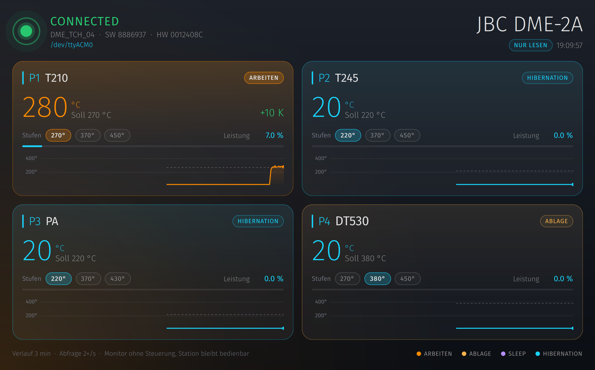
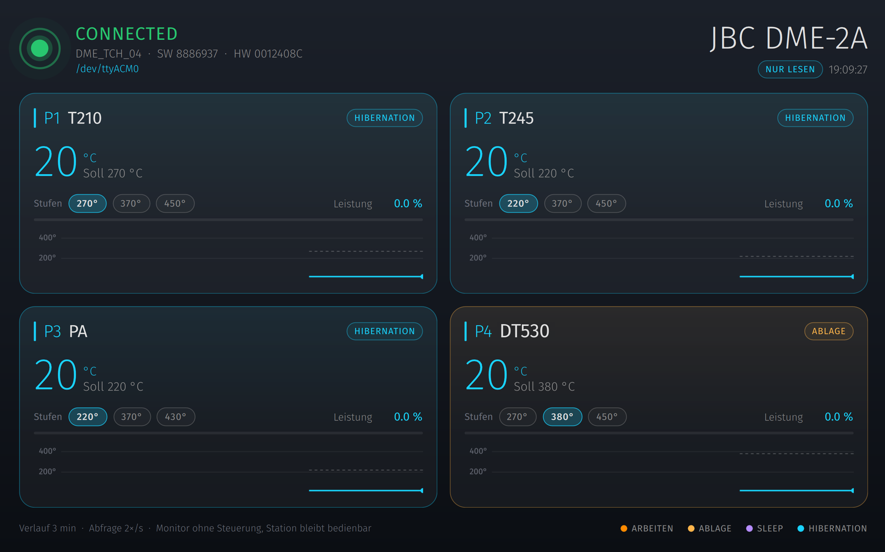

# JBC DME-2A Monitor

Reads a JBC DME-2A soldering station over its USB-B port and shows all four ports
live: tip and set temperature, temperature levels, state, power, history.
The station stays fully usable. The only thing the monitor changes are the
three temperature levels, and only when you ask for it (see below);
`--readonly` turns that off completely.





## Run

```sh
pip install -r requirements.txt
./jbc-gui.sh                  # find the station automatically
./jbc-gui.sh --port /dev/ttyACM0
./jbc-gui.sh --demo           # without a station
./jbc-gui.sh --readonly       # never write to the station
```

### Temperature levels

| Action | Effect |
|---|---|
| Double click on a level | makes it the active level |
| Ctrl+Shift+mouse wheel on the **active** level | ±5 °C per notch, sent 0.7 s after the last notch |

The mouse has to be on the level. Without Ctrl+Shift the wheel does nothing.
Values are limited to the station's min/max temperature. After writing, the
levels are read back. A short message confirms or reports the error.

Access to `/dev/ttyACM*` via the `uucp` or `dialout` group.

## Library

```python
import jbc_dme
d = jbc_dme.DME()
print(d.connect())
for p in d.read_all():
    print(p["port"], p["tool"], p["state"], p["temp"], p["set"])
d.close()
```

`jbc_dme.py` has no dependencies. By default it only sends read commands;
`DME(allow_write=True)` additionally allows `set_level_temp(port, level, °C)`
and `select_level(port, level)` (ports and levels count from 0).
Protocol: [PROTOCOL.md](PROTOCOL.md).

## Tools

```sh
python3 tools/jbc_probe.py                  # identification + raw data
python3 tools/jbc_monitor.py --csv log.csv  # logging
```

## Tested

DME-2A (`DME_TCH_04`, SW 8886937) with T210, T245, PA, DT530.

## Note

JBC is a trademark of JBC Soldering S.L. Not affiliated with JBC; contains no code
or files from JBC.

## License

MIT

LLM assisted development
